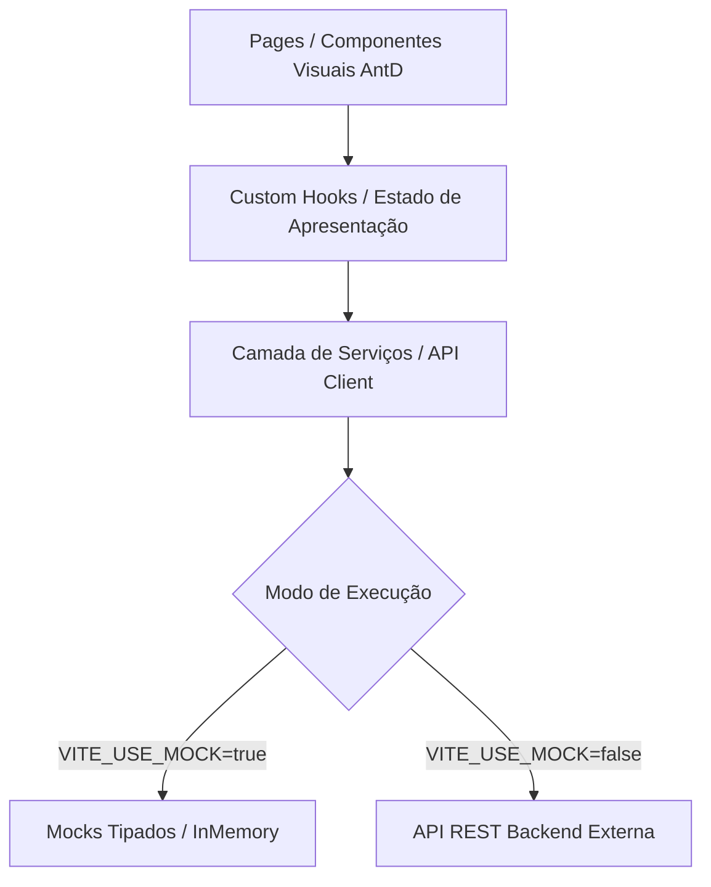

# Arquitetura do Frontend: Gestão Inteligente de Treinamentos Internos de RH

Este documento descreve a estrutura arquitetural da aplicação frontend, a divisão de responsabilidades entre módulos, a estratégia de estado e a camada de integração com serviços.

---

## 1. Visão Geral da Arquitetura

O frontend é desenvolvido como uma Single Page Application (SPA) utilizando **React + Vite + TypeScript + Ant Design**, estruturado para permitir desenvolvimento ágil durante o hackathon e facilitar a posterior integração com a API do backend sem retrabalho de componentes visuais.



---

## 2. Estrutura de Diretórios (`src/`)

```
src/
├── assets/             # Recursos estáticos (logos, ícones customizados, imagens)
├── components/         # Componentes compartilhados e reutilizáveis
│   ├── layout/         # MainLayout, AppHeader, AppSider, AppFooter
│   ├── common/         # PageHeader, StatusBadge, EmptyState, LoadingCard
│   └── camera/         # CameraCaptureModal (interface de captura facial client-side)
├── pages/              # Telas da aplicação (módulos funcionais)
│   ├── rh/             # Dashboard do RH (indicadores, listagem, cadastro)
│   ├── leader/         # Portal do Líder (catálogo e alocação de equipe)
│   ├── instructor/     # Painel do Instrutor (chamada e captura)
│   ├── certificates/   # Emissão e visualização de certificados
│   └── public-verify/  # Validação pública de certificados por código/QR
├── services/           # Clientes HTTP e contratos de comunicação com a API
│   ├── api.ts          # Configuração base de requisições (fetch / axios abstraction)
│   ├── training.ts     # Serviços para Treinamentos
│   ├── attendance.ts   # Serviços para Chamada e Presença
│   └── certificate.ts  # Serviços para Certificados
├── mocks/              # Dados simulados para desenvolvimento visual independente
│   ├── trainingMock.ts
│   ├── attendanceMock.ts
│   └── certificateMock.ts
├── types/              # Definições de tipos TypeScript compartilhados
│   ├── training.ts
│   ├── attendance.ts
│   └── certificate.ts
├── routes/             # Definição e mapeamento de rotas (React Router)
│   └── index.tsx
├── styles/             # Estilos globais e customizações de CSS
│   └── index.css
├── App.tsx             # Componente raiz com ConfigProvider (Ant Design) e Router
└── main.tsx            # Ponto de entrada do Vite
```

---

## 3. Divisão de Responsabilidades

### Camada de Apresentação (`pages/` e `components/`)
- Responsável única pela renderização da interface e captura de eventos do usuário.
- Utiliza componentes nativos do Ant Design (`Table`, `Card`, `Form`, `Modal`, `Button`, `Tag`).
- Não implementa lógica de persistência, regras de negócio de backend ou queries diretas a bancos de dados.

### Camada de Tipagem (`types/`)
- Garante integridade estrutural em toda a aplicação.
- Modela os contratos de dados esperados pelo frontend: `Training`, `Session`, `Employee`, `AttendanceRecord`, `Certificate`.

### Camada de Serviços (`services/`) e Mocks (`mocks/`)
- Isola completamente as chamadas HTTP. As páginas consom apenas funções assíncronas tipadas (`getTrainings()`, `registerAttendance()`, `verifyCertificate()`).
- Uma flag de ambiente (`VITE_USE_MOCK`) permite alternar entre dados simulados e endpoints reais da API fornecida pelo time de backend.

---

## 4. Roteamento e Navegação

| Rota | Módulo | Descrição |
| :--- | :--- | :--- |
| `/` ou `/rh` | Dashboard do RH | Indicadores, catálogo e criação de novos treinamentos |
| `/lider` | Portal do Líder | Catálogo de treinamentos e alocação de colaboradores |
| `/instrutor` | Painel do Instrutor | Lista de convocados e chamada assistida por captura facial |
| `/certificados` | Certificados | Emissão, consulta e exportação de certificados |
| `/validar` | Validação Pública | Consulta e validação de autenticidade aberta ao público |

---

## 5. Diretrizes de Integração com o Backend
1. **Contratos Claros:** O frontend aguarda a disponibilização das rotas do backend sem inventar regras de negócio no cliente.
2. **Tratamento de Falhas:** Tratamento preventivo de erros de rede (401, 404, 500) com mensagens amigáveis via componentes do Ant Design.
3. **Imutabilidade e Tipagem Estrita:** Nenhum dado não-tipado (`any`) deve fluir entre os serviços e a UI.
